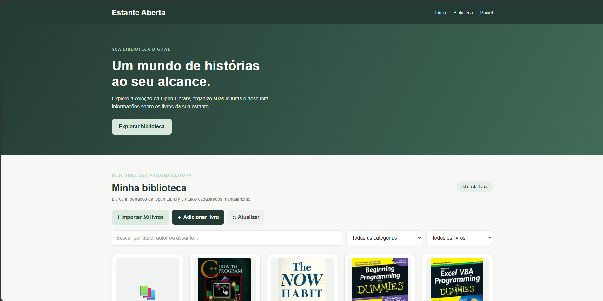
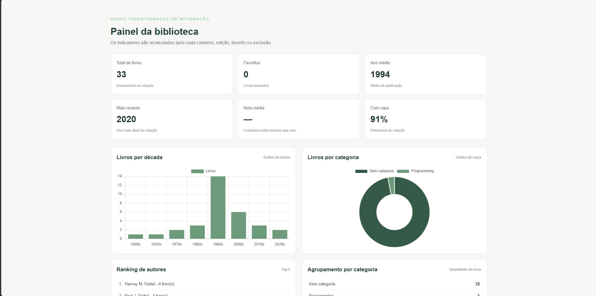
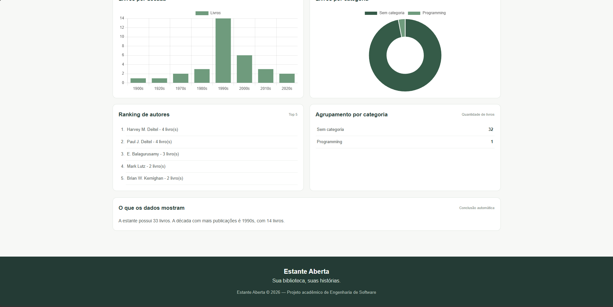
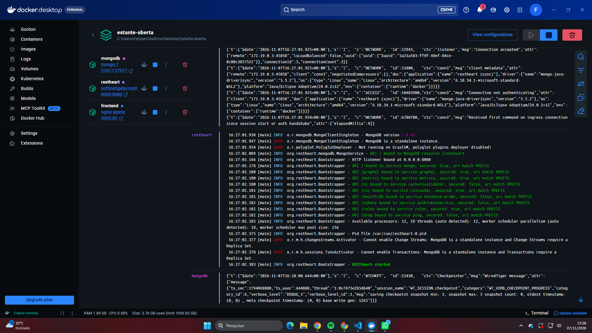

# Estante Aberta

Projeto desenvolvido para a atividade prática de Banco de Dados, utilizando uma API pública, MongoDB, RESTHeart e Docker.

## 1. Integrantes

- Fellype Gabriel Carlins
- Kelly Neuendorf
- Nahayana Kermilin Vieira

*Divisão de tarefas:*
- Dados e Docker: Kelly Neuendorf (Auxilio no README)
- API e HTTP: Nahayana Kermilin Vieira (Auxilio no Frontend)
- Frontend: Fellype Gabriel Carlins (Auxilio no README)

## 2. Tema e API utilizada

*Tema:* Livros

*API:* [Open Library](https://openlibrary.org/developers/api)

A aplicação busca livros sobre programação e salva até 30 registros no MongoDB.

## 3. Como executar o projeto

É necessário ter o Docker Desktop instalado e em execução.

Na pasta principal do projeto, execute:

powershell
docker compose up -d

Para verificar os containers:

powershell
docker compose ps

A aplicação estará disponível em:

- Frontend: http://localhost:3000
- RESTHeart: http://localhost:8080
- MongoDB: localhost:27017

Para parar os containers:

powershell
docker compose down

Para apagar os containers e os dados armazenados:

powershell
docker compose down -v

## 4. Modelo do documento JSON

Exemplo de documento utilizado na coleção books:

json
{
  "titulo": "Livro de exemplo",
  "autores": ["Autor de exemplo"],
  "anoPublicacao": 2024,
  "numeroEdicoes": 1,
  "capaId": "",
  "assuntos": ["Programação", "Tecnologia"],
  "favorito": false,
  "nota": 0,
  "comentario": "",
  "importadoEm": "2026-11-06T12:00:00.000Z",
  "atualizadoEm": "2026-11-06T12:00:00.000Z",
  "origem": {
    "api": "Cadastro manual",
    "obraKey": "manual-exemplo",
    "url": ""
  }
}

Os autores e assuntos são listas embutidas, e a origem é um objeto embutido. Esses dados ficam junto ao livro porque são utilizados nas consultas e na exibição das informações.

## 5. Métodos HTTP

As operações são realizadas no RESTHeart, utilizando a coleção books.

| Método | Endpoint | Status esperado |
|---|---|---|
| PUT | /books | 201 |
| POST | /books | 201 |
| GET | /books?pagesize=100 | 200 |
| GET | /books/{id} | 200 ou 404 |
| PUT | /books/{id} | 200 |
| PATCH | /books/{id} | 200 |
| DELETE | /books/{id} | 204 |

A autenticação local do RESTHeart utiliza usuário admin e senha secret.

A coleção de requisições do Postman está disponível na pasta postman.

## Prints do sistema

### Biblioteca de livros

### Painel de indicadores

### Painel de indicadores

### Ambiente Docker

## 7. Conclusão

Com os livros cadastrados, o painel permite observar a distribuição das publicações por década, os assuntos mais frequentes e os autores com maior número de obras. Os gráficos e indicadores facilitam a visualização dessas informações e ajudam a identificar as principais características da coleção.

## 8. Uso de inteligência artificial

A inteligência artificial foi utilizada como apoio para esclarecer dúvidas, revisar e organizar partes do código. O grupo revisou o projeto e participou do desenvolvimento das funcionalidades. Foi utilizada para apoio no desenvolvimento do Frontend e para retirar dúvidas sobre a API.